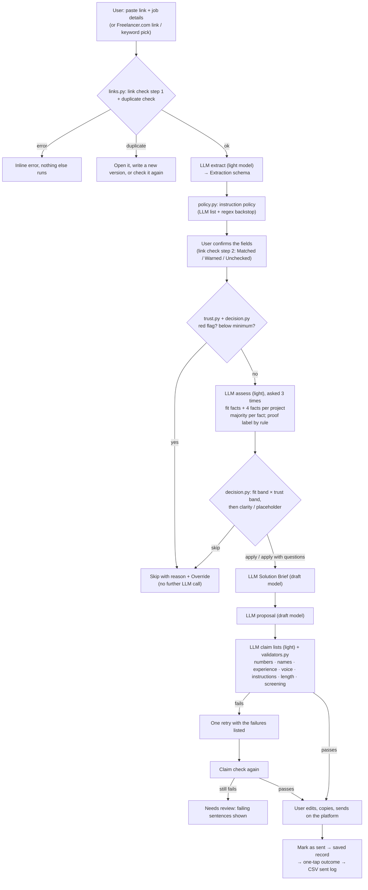

# Architecture and data flow

Code decides; the LLM extracts and writes; the user approves twice and always sends. The fit check is on by default; the user can untick it to go straight to the draft, which skips the assessment call and turns red flags and a low budget into warnings instead of a Skip. Every rule that judges a job (trust, budget, fit × trust, link and duplicate checks, the instruction policy, the claim check) runs in plain Python and is unit-tested with no LLM.

## Data flow

## Boundaries

| Layer | Module | What it owns | LLM? |
| --- | --- | --- | --- |
| Contracts | `proposal_v2/contracts.py` | One Pydantic schema per step, shared by prompt, parser and validator | — |
| Rules | `links.py`, `trust.py`, `decision.py`, `policy.py`, `skills.py` | Link check, job key, trust score (Freelancer.com rule included), budget gate, placeholder rule, fit band, majority vote, proof label, decision, instruction policy | No |
| Validation | `validators.py` | The three-part claim check, voice, instructions, length, screening answers | Uses the claim lists |
| Models | `llm.py`, `prompts.py` | Gemini first, Groq fallback, response cache, replay mode, run log | Yes |
| Workflow | `pipeline.py` | Step order, the one retry, overrides, revisions, send and outcomes | Calls `llm.py` |
| Data | `storage.py` | Local JSON or Firestore, same paths: `users/{uid}/proposals/{job_key}`, `projects/{id}`, `settings/profile` | — |
| Tools | `integrations.py` | Freelancer.com public API, PDF text | — |
| Interface | `app.py` (Streamlit), `scripts/cli.py` | Passphrase gate, screens, session state keyed by job key | — |
| Evaluation | `evaluation.py`, `scripts/run_evals.py`, `scripts/judge.py` | Frozen fixtures, per-case checks, CSV, judge with labels removed | Cached |

## Models and calls

| Step | Model role | Default model | Calls per job |
| --- | --- | --- | --- |
| Extraction | light | Gemini 3.5 Flash-Lite | 1 |
| Assessment | light | Gemini 3.5 Flash-Lite | 3, majority vote per fact (0 for red-flag and below-minimum jobs) |
| Solution Brief | draft | Gemini 3.8 Flash | 1 per Apply |
| Proposal | draft | Gemini 3.8 Flash | 1, plus 1 on retry |
| Claim lists | light | Gemini 3.5 Flash-Lite | 1, plus 1 on retry |
| Fallback | — | A busy Gemini model is retried after 3 s and 8 s, then the other Gemini model, then Groq models in order (`openai/gpt-oss-120b`, `openai/gpt-oss-20b`) | When Gemini is busy, rate-limited or failing |
| Judge (evals) | judge | Groq (`qwen/qwen3.8-27b`, a different model family from the drafters, then `openai/gpt-oss-20b`) | 1 per draft |

An Apply job makes 2 calls on 3.8 Flash (free tier: 20 a day), so caching and the Groq fallback matter. Model names live in `config.toml`.

## Trade-offs

| Choice | Why | Cost |
| --- | --- | --- |
| Rules in code, not prompts | Decisions are explainable, testable without an LLM and adjustable in Settings | Rules are rough heuristics; tuned by hand |
| Facts from the model, asked 3 times; labels from code | A single answer flipped between runs; a majority of three, plus "similar" only with a tool named in both texts, holds | 2 extra light-model calls per checked job |
| Claim check = LLM lists + code checks | The model finds sentences; code decides what's allowed | Misses what the model doesn't list; measured against hand labels |
| Regex backstop for instructions | The policy holds even if extraction misses an instruction | Can over-match; flagged instructions are shown to the user |
| Paste first, official APIs only | Upwork has no API access in time and its terms forbid page fetching | The user copies the page by hand |
| Streamlit | A live link and a UI in one Python file | Reruns on every click; state is keyed by job key |
| Local JSON first, Firestore optional | Works anywhere, no setup | Streamlit Cloud loses local files on restart; Firestore fixes that |
| Response cache + replay mode | Evals and the demo run the same every time, offline, with no quota | Cache must be refreshed (`--record`) after prompt changes |

## Privacy and permissions

- The app asks for the passphrase before anything loads; no storage access or LLM call runs without it.
- The user's workspace and the sample workspace are separate (`uid` on every record).
- Secrets live in `.env` or `st.secrets`, never in code or config.
- Job text reaches the model as quoted data inside tags, apart from the system's instructions.
- Gemini's free tier may use content to improve Google's products; use a paid key before anyone else's data goes in.
- Nothing is ever submitted to a platform: the user copies the draft and sends it.
