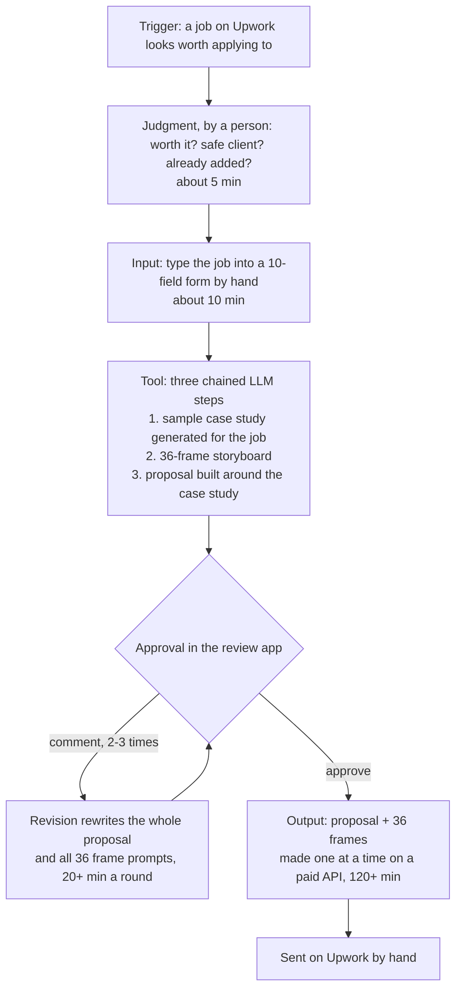
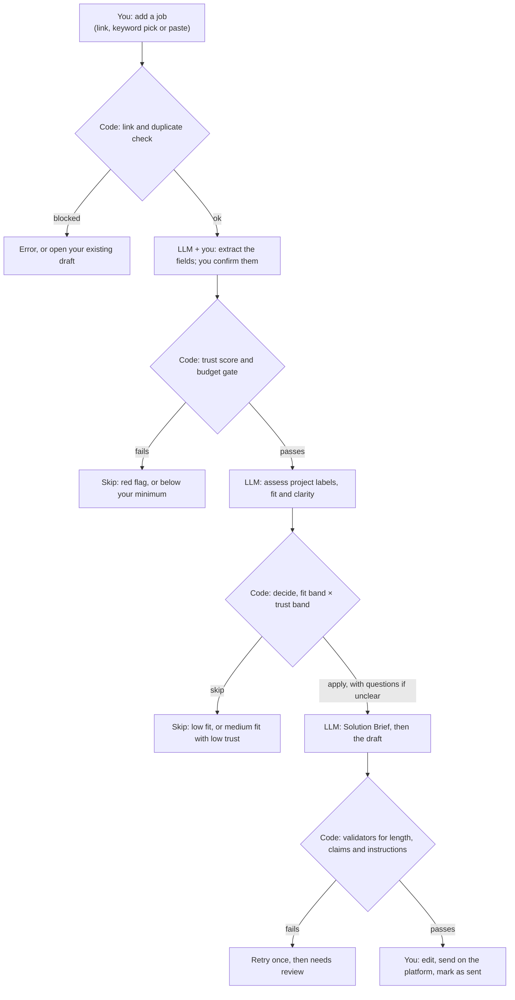

# Workflow map

The bottleneck sits before any drafting starts. In v1, a person chose every job and typed it in by hand, and the LLM chain then drafted it.

## v1: the previous way of working

| Element | In v1 | Who or what |
| --- | --- | --- |
| Trigger | A job on Upwork looks worth applying to | Person, chosen by hand |
| Input | The job's details, typed into a 10-field form: about 10 min | Person |
| Judgment | Is it worth it, is the client safe, was it already added? About 5 min per job | Person, before entry; v1 was built to draft every job it was given |
| Tool | Three chained LLM steps: a sample case study generated for the job (a company, a scenario and its results, an agency sales format), a 36-frame storyboard, then a 250–450-word proposal built around the case study | LLM |
| Approval | Approve in the review app, or comment to revise: about 7 min to review, then 2–3 revision rounds of 20+ min each to make it unique and personal. A revision rewrote the proposal and all 36 frame prompts | Person |
| Output | The approved proposal plus 36 frames, each generated one at a time on a paid image API and polled every minute (120+ min per approved proposal), then sent on Upwork by hand | Image API, then person |
| Exceptions | Unclear posts, instructions inside posts, client checks and duplicates were handled by a person, outside the flow. Under load, access tokens expired mid-run, which I solved with a token-refresh branch | Person; token refresh in the flow |

## Plain ChatGPT: the other previous way

The way a freelancer without a pipeline works, timed step by step on T01–T03 ([baseline](../evals/baseline.md)).

| Element | With plain ChatGPT | Minutes |
| --- | --- | --- |
| Trigger | A job looks worth applying to | |
| Input | Find and paste the job; pick which projects fit; write a background for this job | 15 |
| Judgment | Done by me, if at all; ChatGPT drafts whatever it's given | |
| Tool | One ChatGPT answer | 0.5 |
| Approval | Read and fix the first answer, then 3+ revision rounds, each adding odd things to find and remove | 41.5 |
| Output | A correct but generic proposal, sent by hand | |
| Exceptions | No client check, no skip path and no duplicate check | |

## v2: the planned flow

The keyword feed only lists new matching jobs, each with a trust label, and decides nothing; I pick which job to open. From there, code decides, the LLM extracts and writes, and I approve twice: the extracted fields and the final draft. Every Skip shows its reason and an Override button, and nothing is ever submitted for me.

| Approval point | What the person checks |
| --- | --- |
| Extracted fields | Title, budget, client stats and instructions, before any decision |
| Decision card | One decision and one reason; Override on every Skip, logged |
| Final draft | The text, the chosen proof and any claim-check notes, before sending |
